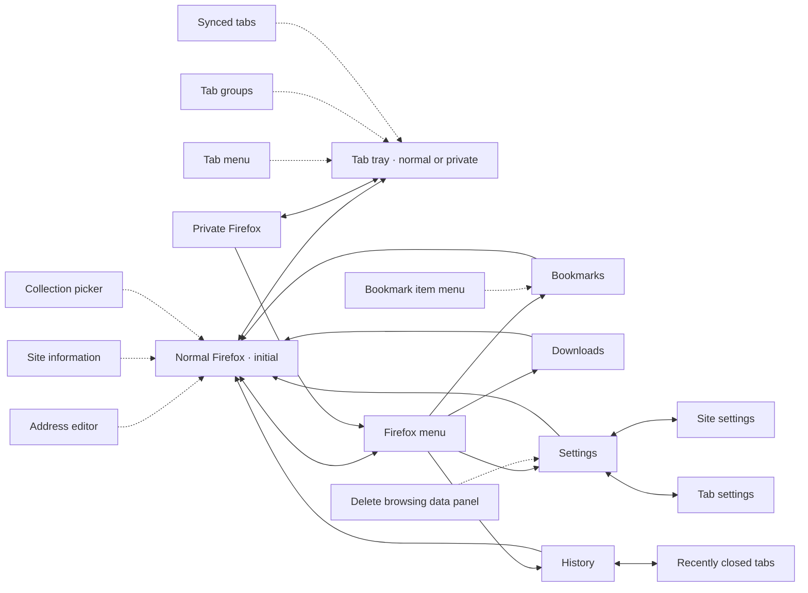

# Firefox Android capability map and ground-truth scenarios

Firefox Android support targets **`org.mozilla.firefox` 160.0.1** on Android with an **English (`en*`)** system locale. Compatibility with other Firefox versions or non-English locales has not been tested and is not claimed.

## StateGraph

The initial state is the normal browser surface (`browser_state`). Firefox Home and a loaded page share the same toolbar contract in each browsing mode. Transitions from `tabs_state` to `browser_state` or `private_browser_state` select an existing visible tab card whenever available, avoiding unintended tab creation; only when zero tabs exist in the target tray does recovery open a blank tab and emit a `WARNING` log with `stage=STATE_RECOVERY_MUTATION`. Returning from shared panels resolves to `browser_state`.

Solid arrows show navigable transitions. Dotted arrows show exits from `recognize_only` states. `has_collection()` runs in `browser_state` as a strictly read-only inspection of `homepage.view` and raises `FirefoxPreconditionError` if Firefox Home is not currently visible rather than silently opening a tab.

The popup handlers cancel the system default-browser chooser and skip the in-app default-browser offer. The Firefox notification prompt uses Android Back. The first-run agreement is completed manually before automation.

## Ground-truth provenance, side effects and retry safety

- **Structured Firefox GTL provenance:** Every Firefox action emits UTC ISO-8601 timestamps (`ts=...+00:00`), monotonic correlation identifiers (`action_id=ff-0001`, ...), and explicit lifecycle stages: `INTENDED`, `ATTEMPTED`, `OBSERVED`, `VERIFIED`, `FAILED`, `AMBIGUOUS`, `INCONCLUSIVE`, `RETRY_SUPPRESSED`, and `STATE_RECOVERY_MUTATION`.
- **Non-idempotent retry protection:** PUMA's global `@action` decorator retries once on any exception. Firefox maintains a local commit-point record so failures after a mutating UI trigger (`press_enter`, `Add tab`, `Close tab`, `Bookmark page`, `Delete`, `performEditorAction('done')`, PDF `Download`) either confirm the postcondition read-only without a second click (`close_tab`, `add_bookmark`, `delete_bookmark`) or suppress duplicate re-execution and raise `FirefoxAmbiguousActionError` / `FirefoxNavigationError`.
- **`verify_with` behaviour:** PUMA's `verify_with` hook logs `Action '<name>' failed` to GTL and continues execution without raising. Callers requiring hard failure on mismatched navigation destinations should pass `expected_url`, `expected_title`, or `expected_text` to `visit_url` / `visit_url_private` / `search`.
- **Navigation verification:** `_submit_address` rejects stale WebView content by matching the displayed destination address against the requested URL (scheme/host/port/path/query normalized), failing fast on `errorPageContainer`, and enforcing any explicit `expected_url`, `expected_title`, or `expected_text` predicates before reporting completion. Revisiting a URL that already matches the prior displayed address is logged explicitly as indistinguishable from a prior page without title/text or server-side confirmation.
- **Tracking-protection attribution:** `_parse_site_info` scopes `On`/`Off` and `checkable` switch inspection strictly to the container associated with an `Enhanced Tracking Protection` / `Tracking Protection` label or resource ID, returning `'unknown'` when absent and `'ambiguous'` on conflicting indicators rather than grabbing an unrelated setting.

## Reusable scenarios (deterministic vs external dependencies)

Run [test_scripts/test_firefox.py](../test_scripts/test_firefox.py) in a dedicated Firefox profile with an output directory outside the source checkout. Each run generates a UTC-based `run_id`, records device/app/OS/locale metadata in `results.json`, and writes UTC ISO-8601 logs to `firefox_gtl.log`.

### Deterministic host-controlled scenarios (default run)

All default scenarios communicate exclusively with the local loopback HTTP fixture over an ADB reverse tunnel:

1. **Controlled URL visit (`visit`):** Open `01-visit` with `expected_title` and verify the exact accessible title and displayed address.
2. **Deterministic query fixture (`search_fixture`):** Navigate to `/<run-id>/02-search-fixture?q=...` and verify HTML-escaped query rendering in the page title without external internet dependencies.
3. **Bookmark creation and removal (`bookmark`):** Bookmark `03-bookmark`, observe the exact URL in visible Bookmarks, delete that unique row, and confirm it disappears from the viewport.
4. **Multiple normal tabs (`tabs`):** Open tabs with distinct titles, switch to `04-tab`, verify the page title, close it, confirm removal from the tray, and observe it in `Recently closed tabs`.
5. **Private browsing (`private`):** Open `05-private` in private mode, verify title and address, switch to and close the exact private tab, and check that the URL is absent from the visible normal History viewport. Android restricts private PNG screenshots (`FLAG_SECURE`); UI XML is retained.
6. **Known PDF download (`download`):** Open `PUMA-Firefox-<run-id>-06.pdf` in Firefox's built-in viewer, click Download, verify the filename in Firefox Downloads, and compare `/sdcard/Download/<filename>` SHA-256 over ADB against the served bytes.
7. **History observation (`history`):** Revisit `01-visit` and require the exact title and URL in visible normal History.
8. **Settings and site privacy (`settings`):** Read general Settings, Enhanced Tracking Protection preferences, Site settings, Tab settings, and the fixture page's site information panel without toggling controls.
9. **Collections (`collection`):** Save `01-visit` to a unique new collection, explicitly call `app.open_tab()` to open Firefox Home, and observe the exact collection name on Home using read-only `has_collection()`.
10. **Tray recovery (`recovery`):** Exercise recovery from `tabs_menu_state`, `groups_state`, `synced_tabs_state`, and `address_edit_state`.
11. **Panel recovery (`panel_recovery`):** Exercise recovery from private `menu_state`, `site_info_state`, `collection_picker_state`, `bookmark_menu_state`, and view-only `delete_data_state`.

### External-dependency scenario (opt-in only)

12. **External default search (`search`, enabled via `--include-external-search` or `--case search`):** Submits `PUMA Firefox <run-id> 02 synthetic search` through Firefox's configured search engine (e.g. Google). Because external search engines control network responses, consent walls, CAPTCHAs, and title formatting, this scenario is excluded from the default deterministic run and reports `inconclusive` rather than a hard failure if the external title template differs.

## Environment assumptions and selector resilience

- **Tested environment:** Android physical device, English (`en*`) locale, `org.mozilla.firefox` `160.0.1`, Appium UiAutomator2.
- **Resource-ID backed selectors (higher resilience):** `ADDRESSBAR_URL_BOX`, `ADDRESSBAR_SEARCH_BOX`, `ADDRESSBAR_TABS_COUNTER`, `homepage.view`, `org.mozilla.firefox:id/engineView`, `errorPageContainer`, `bookmarks.toolbar`, `historyLayout`, `history_list`, `recently_closed_tabs_header`, `recentlyClosedLayout`, `createCollectionWrapper`, `name_collection_edittext`, `unified.trust.panel.website.url`, `recycler_view`, `navigationToolbar`, `android:id/title`, `android:id/button2`, WebView PDF `@resource-id='download'`.
- **English `content-desc` / `@text` selectors requiring regression checks on Firefox upgrades or locale changes:** `BROWSER_PRIVATE` / `BROWSER_NORMAL` tab-counter prefixes, `TABS_ADD_NORMAL` / `TABS_ADD_PRIVATE` / `TABS_EXISTING_CARD` (`Close tab `), `TABS_SELECT_*` / `TABS_GROUPS_SELECTED` / `TABS_SYNCED_SELECTED`, `MENU_*` (`More options`, `Close menu`, `Bookmark page`, `Edit bookmark`, `More Collapsed`, `Save to collection`), `BOOKMARKS_MENU_*`, `COLLECTION_ADD` / `COLLECTION_SAVED`, `SETTINGS_*` labels, and `POPUP_*` dialog strings.

## Verification status: what tests establish and do not establish

### Offline automated verification (current hardened revision)

- **Firefox-specific unit tests (`test.test_firefox`):** 43 passed, 0 failed, 0 skipped.
- **Repository-wide offline suite (`unittest discover test`):** 372 passed, 0 failed, 1 skipped (373 total; zero regressions across existing PUMA tests).
- **What offline tests establish:** StateGraph structural validity and reachability; read-only queries (`has_collection`, `_return_to_browser`, tab-tray transitions, `inspect_*`) avoid creating tabs or bookmarks; navigation rejects stale WebView content, detects error pages, and enforces destination constraints; commit-point retry guards prevent duplicate mutations across PUMA's `@action` retry path; site-info tracking-protection parsing ignores unrelated settings and surfaces `unknown`/`ambiguous` explicitly; XPath syntax validity (`elementpath`) and quoting edge cases; structured UTC provenance logging; local HTTP fixture serving, HTML escaping, PDF SHA-256 consistency, and capture-outside-checkout CLI enforcement.
- **What offline tests do NOT establish:** Real Firefox 160.0.1 UI rendering, timing, Compose/Android View hierarchy behaviour on physical hardware, Appium UiAutomator2 gestures (`mobile: scrollGesture`, `mobile: performEditorAction`), actual Android `FLAG_SECURE` behaviour, or on-device file downloads.

### Physical-device verification requirements

- The previously recorded 11/11 live physical-device run validated the **original published candidate (`d697a68`)**, **not** this hardened revision.
- Before claiming live verification of this hardened revision, re-run `test_scripts/test_firefox.py` on a dedicated English-locale Android device with `org.mozilla.firefox` `160.0.1` installed, paying particular attention to:
  1. `_enter_browser_from_tabs` clicking `xp.TABS_EXISTING_CARD` in normal and private tab trays on real Firefox 160.0.1.
  2. `_submit_address` destination URL matching against live `ADDRESSBAR_URL_BOX` `content-desc` values (including `02-search-fixture` with query strings and PDF URLs).
  3. `_parse_site_info` output on Firefox 160.0.1's actual Unified Trust Panel XML (confirming `'On'`/`'Off'` vs `'unknown'`/`'ambiguous'`).
  4. Explicit `app.open_tab()` followed by read-only `app.has_collection(name)` in the `collection` scenario.
  5. Postcondition waits (`wait_until_not_present`) on `add_bookmark`, `delete_bookmark`, and `close_tab`.

## Forensic scope and limitations

- UI observations (visible History, Bookmarks, Recently closed tabs, Downloads, Collections, Settings, Site Info) reflect only the currently rendered viewport and do **not** establish underlying SQLite/profile database persistence, cache contents, or WAL/journal state.
- Absence of a private URL from the visible normal History list does **not** prove private-session artefacts are unrecoverable from device storage or memory.
- Downloads are the only on-disk artefact checked by the device script, via `/sdcard/Download/<filename>` SHA-256 comparison.
- Bookmark folders, pagination beyond the visible list viewport, reopening recently closed tabs, private PNG screenshots, adding to existing collections, Firefox Sync, tab group creation, and bulk browsing-data deletion remain outside scope.
