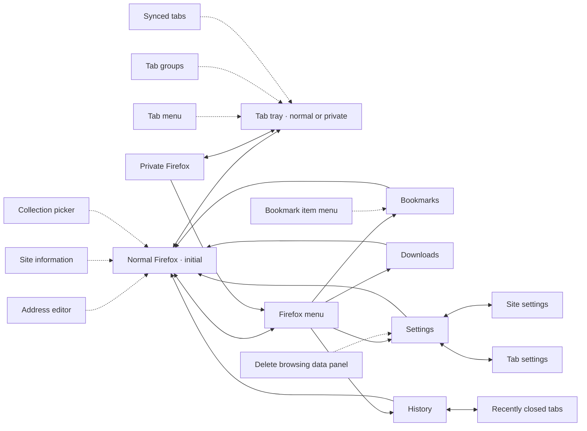

# Firefox Android capability map and ground-truth scenarios

Firefox Android support targets org.mozilla.firefox 160.0.1.

## StateGraph

The initial state is the normal browser surface. Firefox Home and a loaded page share the same toolbar contract in each browsing mode. The tab tray selects normal or private mode before starting a new tab or selecting an existing card. Returning from a shared panel resolves to the normal browser surface.

Solid arrows show navigable transitions. Dotted arrows show exits from recognize-only states. State matching uses Firefox's `ADDRESSBAR_*` resource identifiers, the tab counter's normal and private descriptions, menu controls, and panel-specific toolbar or layout locators. Exact tab titles and bookmark URLs select the row within the current viewport. The normal and private tab strips share a tray state, with mode determined from the corresponding Add button.

The popup handlers cancel the system default-browser chooser and skip the in-app default-browser offer. The Firefox notification prompt uses Android Back. The first-run agreement is manual. The private-tab-lock offer and tab-group tip coexisted with the tested tray controls.

## Reusable scenarios

Run [the device script](../test_scripts/test_firefox.py) in a dedicated Firefox profile. Each run uses a UTC-based identifier with a random suffix. The ADB reverse tunnel sends controlled navigation to a host loopback server. HTML pages carry the run identifier and sequence in the title and URL. The generated PDF carries the same identifier in its body and filename. For studies requiring separate timestamps, keep the same action sequence and pace the calls to suit the acquisition plan.

1. **Controlled URL visit.** Open `01-visit` and check the exact accessibility title and address. The physical run observed both.
2. **Synthetic search.** Submit `PUMA Firefox <run-id> 02 synthetic search` to the configured Google engine. Firefox placed the terms in the toolbar. The Google Search page title included the exact query. This step uses the network and Google controls the response.
3. **Bookmark creation and removal.** Bookmark `03-bookmark`, check its exact URL in Bookmarks, delete that row, and check again. The row appeared and then disappeared.
4. **Multiple normal tabs.** Open tabs with distinct page titles, switch to `04-tab`, verify the page title and close it. Check the normal tray and Recently closed tabs. The closed tab disappeared from the tray and its exact title was recovered from the Recently closed list.
5. **Private browsing.** Open `05-private` in private mode, verify the title and address, then switch to and close the exact private tab. The URL was absent from the visible normal History viewport. Android restricted private PNG capture and the runner retained XML.
6. **Known download.** Open `PUMA-Firefox-<run-id>-06.pdf` in the Firefox viewer and click Download. Verify the exact filename in Firefox Downloads. Read the public Android Downloads file over ADB and compare SHA-256 with the served bytes.
7. **History observation.** Revisit `01-visit` and require the exact title and URL in visible normal History. Preserve the UI evidence and action timestamps with the run.
8. **Settings and site privacy.** Read general Settings, the Enhanced Tracking Protection preference area, Site settings and tab settings. Inspect the fixture page's site information. These actions read labels and summaries and leave the controls untouched.
9. **Collections.** Save the fixture page to a unique new collection. Check the saved acknowledgement and the exact collection name on Firefox Home. The collection provides a repeatable synthetic object for subsequent acquisition.

Two additional live cases exercise graph navigation and recovery. The tray case visits the tab menu, the groups and synced tabs views, and the address editor. The panel case opens the Firefox menu from private browsing and exercises exit from site information, the collection picker, the bookmark item menu and the Delete browsing data panel. The last panel is opened for inspection only.

The runner writes scenario outcomes to `results.json` and action timestamps to `firefox_gtl.log`. Diagnostic XML and available PNGs sit beside them.

## Scope and limitations

- Implementation covered 9 of 9 scoped feature groups. Live action coverage was 21 of 21. The two recovery cases measure graph behavior.
- Bookmarks, History, Recently closed tabs, Download checks and tab selection operate on visible UI entries. Bookmark folders, tab and history pagination, reopening recently closed tabs, private screenshot capture, adding to existing collections, sync, group creation and bulk deletion sit outside the exercised workflow.
- Download support covers the built-in PDF viewer and the visible Downloads list. Other download types and confirmation dialogs were outside this live test.
- Private browsing findings concern the visible normal History list. Downloads are the only on-disk artifact checked in this run, using the public Downloads path. Firefox profile databases, caches, private-session remnants and collection storage require a separate acquisition and analysis.
- App launch or authorization dialogs can differ on a fresh profile. Complete the first-run agreement before running the script.
